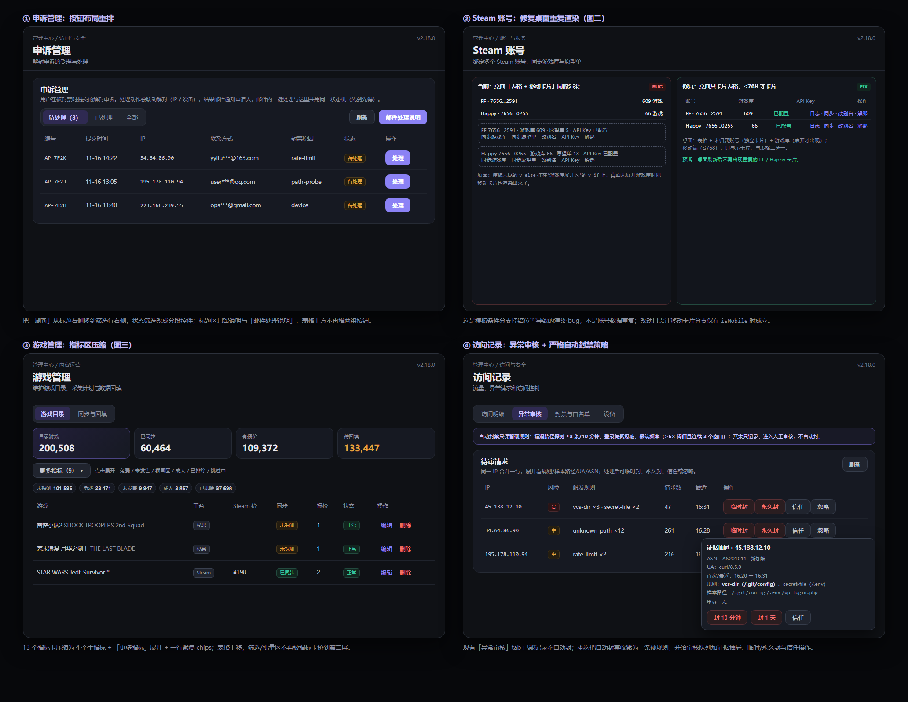

# 后台体验与安全策略：申诉布局 / Steam 账号重复渲染 / 指标压缩 / 自动封禁收紧（待开发）

> 状态：**已实现并发布 v2.21.0（2026-11-17）**。编号 **CF**。
> 关联：[BAN-AND-SECURITY-FIXES.md](BAN-AND-SECURITY-FIXES.md)（BJ/BR 批：白名单、三振、审核）、
> [APPEAL-SYSTEM.md](APPEAL-SYSTEM.md)（申诉状态机）、[TODO.md](TODO.md) 的 CF 条目。

## 1. 现状与根因（2026-11-16 后台截图核对）

| # | 现象 | 根因（代码证据） |
|---|---|---|
| 1 | 申诉管理：标题右侧「刷新」+ 下方三个自绘 tab，两组按钮分散、显挤 | `AppealsAdmin.vue:117-121`：刷新在 `card-heading` 内，tab 是 `module-tabs` 独立一行 |
| 2 | Steam 账号：桌面表格下又出现重复的 FF/Happy 卡片 | **渲染 bug**：`AdminExtras.vue:49` 的"游戏库展开区"是 `v-if="!isMobile && activeAccount && libraryGames.length"`；`:54` 的移动卡片是 `<template v-else>`——**v-else 挂在了游戏库区的 v-if 上**，桌面未展开游戏库时移动卡片也被渲染（不是数据重复） |
| 3 | 游戏管理：13 个指标卡占掉近半屏，表格被挤到第二屏 | `AdminModules.vue` 的 `metric-grid` 一次性渲染全部指标 |
| 4 | 访问记录：自动封禁易误伤，审核入口不明显 | `ratelimit.js` 频率三振（页面 120/分、API 150/分、资源 300/分 → 10min/30min/当天）；`guard.js` 路径签名**只记录不封禁**；审核在「异常审核」tab，证据与操作不够顺手 |

**结论**：图二是纯前端分支错误；图四的"危险请求"目前只由**频率**触发自动封禁，**路径扫描反而只进审核**——需要把自动封禁改为"只封明确恶意、其余人工"。

## 2. 布局改版（①②③，效果图已确认）

### 2.1 申诉管理（①）

- 标题区只留标题/说明 + 「邮件处理说明」；
- **筛选行**：左侧分段控件「待处理（N）/已处理/全部」，右侧「刷新」；
- 表格、空态统一间距；移动端只卡片；不新增搜索/导出（本批不做）。
**申诉可见/可提交（2026-11-16 确认）**：

- **所有封禁类型**（IP 黑名单 / 设备封禁 / 频率三振 / 路径探测）都可以打开 `/appeal` 并提交；
- 未被封访问 `/appeal`：显示「当前未被封禁，无需申诉」，**不展示提交表单**；
- 提交接口校验封禁上下文（取不到封禁记录时提示），保留验证码 + 3 次/小时/IP + 幂等；
- App 不展示申诉入口（App 只做启动黑名单/设备封禁提示，见 APP-NATIVE §3.4）。

### 2.2 Steam 账号（②，修 bug）

- 把 `AdminExtras.vue:54` 的 `<template v-else>` 改为 `<template v-else-if="isMobile">`（或把桌面/移动拆成互斥大块）；
- 桌面：表格 + 未归属账号（独立卡片）+ 游戏库（点开才出现）；
- 移动端（≤768）：只显示卡片；
- 验收：桌面刷新后不再出现重复卡片；移动端仍只有卡片、无表格。

### 2.3 游戏管理（③）

- 主指标保留 4 个：目录游戏 / 已同步 / 有报价 / 待回填；
- 其余 9 个收进「更多指标（N）▾」，默认折叠；
- 未探测/免费/未发售/成人/已排除 等用一行紧凑 chips；
- 表格、筛选、批量区上移；移动端沿用现有卡片逻辑。

## 3. 安全策略：自动封禁收紧 + 人工审核为主

### 3.1 "危险请求"的定义（本批口径）

| 类别 | 判定（默认阈值） | 处置 |
|---|---|---|
| **漏洞路径探测** | 命中 `guard.js` 签名（`.env`/`.git`/`.svn`、`wp-admin`/`phpmyadmin`、`../`、`\0`、`.php`/`.aspx`/`.sql`/`.bak`、`/etc/passwd` 等）；10 分钟内 **≥3 个不同签名路径** | 自动临时封（阶梯） |
| **登录凭据爆破** | 同 IP 15 分钟失败 **≥50 次**（20 次仍只返回 429，账号 5 次锁 15 分钟不变） | 自动临时封（阶梯） |
| **极端频率** | 任一桶超过阈值 **5 倍**且**连续 2 个 60 秒窗口**（页面 >600/分、API >750/分、资源 >1500/分） | 自动临时封（阶梯） |
| **异常 UA 名单** | UA 命中可配置的扫描器名单（默认：sqlmap/nikto/masscan/zgrab/nuclei/wpscan/gobuster/dirbuster/metasploit/acunetix/nessus 等），同一 IP 10 分钟内 ≥2 次 | 自动临时封（阶梯） |
| **普通超频** | 超过 120/150/300 但未到"极端" | **只返回 429**（带 retry-after 与友好页），不封 |
| **普通异常** | 未知路径 <3 条、空 UA、死链/监控/误拼、共享出口突发 | **只进人工审核**，不自动封 |
| **永久黑名单** | 仅管理员手动 | 人工 + 审计 |

> 自动封禁**永不写永久黑名单**；白名单 IP 始终豁免；申诉通过自动解封；误封记录用于调阈值。

### 3.2 封禁阶梯（自动）

- 同一天内：第 1 次 **10 分钟**、第 2 次 **1 小时**、第 3 次及以后 **1 天封顶**；跨天重置；
- 自动封禁写 `ip_abuse`（`ban_source` 标 `auto:path-probe` / `auto:credential` / `auto:extreme-rate` / `auto:ua-list`）；
- 每次自动封禁同时写一条 `abuse_reviews`（rule、detail、path、hits），管理员可在「异常审核」看到并复核；
- 到期自动解除；管理员可提前解封或转永久黑名单（手动）。

### 3.3 限流动作（普通超频）

- 保持 429 + `Retry-After`（不新增人机挑战组件）；
- 429 页面提示"请求过于频繁，请稍后再试"，不展示封禁倒计时（未封）；
- 频率桶保持现状（页面/API/资源分离，BR 批语义不变）。

### 3.4 设置项（热加载约 15 秒）

| key | 默认 | 说明 |
|---|---|---|
| `security.autoBan.mode` | `strict` | `off`（只 429 + 审核）/ `strict`（本节规则）/ `legacy`（旧三振，兼容回退） |
| `security.autoBan.pathDistinctMax` | 3 | 漏洞路径：窗口内不同签名路径数 |
| `security.autoBan.pathWindowSec` | 600 | 漏洞路径窗口 |
| `security.autoBan.credentialIpMax` | 50 | 登录失败/IP/15 分钟 |
| `security.autoBan.extremeMultiplier` | 5 | 极端频率倍数 |
| `security.autoBan.extremeWindows` | 2 | 连续窗口数 |
| `security.autoBan.uaPatterns` | 内置名单 | 逗号/换行分隔；命中视为异常 UA |
| `security.autoBan.banLadderMin` | `10,60,1440` | 阶梯（分钟），跨天重置 |

> 阈值能用页面改的一律走 `settings.js def()`；`mode=off` 时仍保留 429 与人工审核。

## 4. 审核队列（扩展现有「异常审核」）

- 位置：访问记录 → 异常审核（不新建页面）；
- 列表：同一 IP 合并一行，列：IP / 地区 / 风险 / 规则 / 请求数 / 最近时间 / 操作；
- 证据抽屉（点行展开）：
  - 规则与触发次数、样本路径（≤10 条）、UA、地区、设备指纹、首次/最近时间、申诉状态、自动封禁记录（若有）；
  - 若现有表没有的字段（如 ASN）不新增抓取，先用已有字段；
- 操作：**临时封**（10min/1h/1d）、**永久封**（黑名单）、**信任**（白名单）、**忽略**（保留记录）；全部审计（`review.action`，记 by/ip/action/reason）；
- 「自动封禁记录」卡片增加来源（path-probe/credential/extreme-rate/ua-list）与规则详情；
- 批量封禁沿用现有 BulkBar 语义（先不做跨队列批量）。

## 5. 数据与日志

- 复用 `abuse_reviews`（ip/device/fingerprint/rule/detail/path/hits/status/note/reviewed_by/at）与 `ip_abuse`（strikes/banned_until/ban_source/strike_day），**不新增表**；
- 日志：`auto_ban.applied`（ip/rule/until/source）、`auto_ban.skipped`（whitelisted/mode off）、`review.recorded`、`review.action`；
- 指标（可选，落日志即可）：自动封禁次数、人工解封数、待审数。

## 6. 验收

1. **图二 bug**：桌面打开 Steam 账号页不再出现重复卡片；移动端（≤768）只显示卡片、无表格；
2. **图一**：申诉管理筛选行左侧分段、右侧刷新；桌面/移动布局不挤；
3. **图三**：默认只显示 4 个主指标 + 「更多指标」；展开后 9 个可见；表格首屏可见行数明显增加；
4. **普通超频**：121 页面/分或 151 API/分 → 429，**不产生封禁**（`auto_ban.applied` 无记录）；
5. **漏洞探测**：10 分钟内命中 3 个不同签名路径 → 自动封 10 分钟 + 审核记录；白名单 IP 不受影响；
6. **凭据爆破**：同 IP 15 分钟 50 次失败 → 自动封；20–49 次仍只 429；账号 5 次锁 15 分钟不变；
7. **极端频率**：5 倍阈值连续 2 个窗口 → 自动封；单窗口只 429；
8. **UA 名单**：命中名单的 UA 10 分钟 ≥2 次 → 自动封；空 UA 只进审核；
9. **阶梯**：同一天三次自动封分别 10min/1h/1d，第四次仍 1d；跨天重置；**永不自动永久**；管理员可手动解封/转永久；
10. **审核**：证据抽屉展示规则/路径/UA/时间；临时封/永久封/信任/忽略均生效并审计；
11. **设置**：`security.autoBan.mode=off` 时只 429 + 审核；改阈值约 15 秒生效；
12. `npm test` / `npm run frontend:build` / `npm run scan` 全绿。

## 7. 本批不做

1. 人机验证/挑战组件（本批 429；后续另评估）；
2. ASN/威胁情报/第三方 IP 信誉库；
3. 机器学习风险评分；
4. 自动永久黑名单（永久只能人工）；
5. 改申诉状态机与邮件一键处理流程；
6. 跨队列批量封禁/解封。

## 8. 待确认（有默认值，不阻塞）

1. 异常 UA 默认名单是否需要增删（默认 sqlmap/nikto/masscan/zgrab/nuclei/wpscan/gobuster/dirbuster/metasploit/acunetix/nessus）；
2. 漏洞路径单次命中是否也要自动封（当前：单次只审核，≥3 个不同路径才封）；
3. 凭据爆破阈值 50/15 分钟是否合适（20 仍只 429）；
4. 审核列表是否展示地区/UA（若现有数据没有则不新增抓取）。

## 9. 行业做法（2026-11-16 调研）

- Cloudflare 限流最佳实践：登录/注册等敏感端点优先 **Managed Challenge**，只有高置信度才 Block；按 IP+路径+响应状态计数 ——
  [Rate limiting best practices](https://developers.cloudflare.com/waf/rate-limiting-rules/best-practices/)；
- fail2ban：Web 服务 `maxretry` 建议 5–10、先用临时封 + 白名单，递增封禁要防误杀 ——
  [fail2ban 讨论](https://github.com/fail2ban/fail2ban/discussions/3880)；
- OWASP 口径：账号锁定/封禁容易被用来 DoS 真实用户，优先"节流 + 短时锁定"，再叠加 MFA/风险判断 ——
  [Account lockout or throttling](https://safeguard.sh/resources/blog/account-lockout-or-throttling-which-stops-brute-force)。

**采用**：能 429 就不封；要封只封证据明确的硬规则、默认临时、可申诉；模糊情况全部人工审核。
