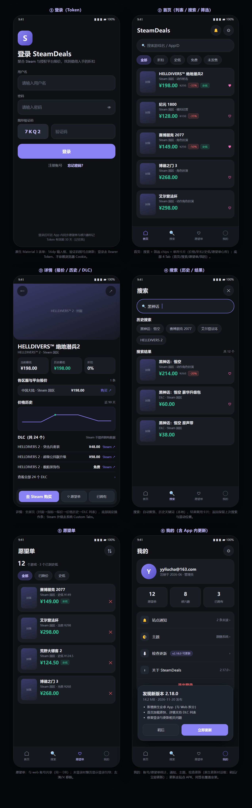

# 原生安卓 App（与 Web 完全拆分，共用同一数据库/后端）（待开发）

> 状态：**已确认待开发（2026-11-16，所有者确认 5 组方向）**。编号 **CA**（CA-1 ~ CA-5）。
> **App 六屏效果图已确认（2026-11-16，见 §10）**：CA-2 起按该基线开发。
> **本批推翻**：[MOBILE-APP-TWA.md](MOBILE-APP-TWA.md)（BS，TWA 复用 web 页面）、
> [MOBILE-REDESIGN.md](MOBILE-REDESIGN.md) 的 BU/BV/BX（移动 web 页面重设计）、
> [MOBILE-APP-UPDATE.md](MOBILE-APP-UPDATE.md)（BY，TWA 内置更新）、
> [MOBILE-APP-REPO-SPLIT.md](MOBILE-APP-REPO-SPLIT.md)（BZ，拆 `android/`）。
> 关联：[MOBILE-REDESIGN.md](MOBILE-REDESIGN.md) BW（后台手机端仍保留）、[TODO.md](TODO.md) 的 CA 条目。

## 1. 已确认的决策（2026-11-16 所有者，5 组）

| # | 决策 |
|---|---|
| 1 | **App 与 Web 完全拆开**：代码/仓库独立、页面 UI 独立、部署/发版独立、认证独立（Token） |
| 2 | **数据库用同一个**：App 不直连数据库，统一走同一后端 API（同一个 PostgreSQL、同一套限流/审计/封禁） |
| 3 | **App 形态：原生 Android**（Kotlin + Jetpack Compose），不做 TWA/WebView 壳 |
| 4 | **手机浏览器前台只给 App 下载页**（不再提供手机网页版前台）；后台 `/console` 仍保留手机端（BW） |
| 5 | **App 功能第一期与 web 对齐**：首页/搜索/详情（价格/DLC/历史）/愿望单/我的/登录注册 |
| 6 | 推进方式：**先规格 + 效果图，再开发**；效果图确认后才开工 |

> 说明：决策 2 的"共用数据库"在实现上是"**共用同一后端 API**"，App 不持有数据库凭据、不直连 PG——
> 否则限流、封禁、审计、金额口径都会绕过服务端。

## 2. 与 Web 的边界（拆分后）

| 层 | Web（站点） | App（原生） |
|---|---|---|
| 前端代码 | 现有 `frontend/`（桌面为主） | 新仓库 `steamdeals-app`（Kotlin/Compose） |
| 页面 | 桌面页面 + `/console` 后台（手机端保留） | 原生页面（与 web 不同） |
| 部署 | 站点发版（Docker 镜像） | APK 发版（GitHub Release + 站点 `/app`） |
| 认证 | Cookie 会话（现状不变） | **Bearer Token**（新增） |
| 数据 | 同一 PG，经同一 Node 后端 | 同一 PG，经同一 Node 后端 |
| 仓库 | `gameprice`（站点 + 后端 + 规格/TODO） | `steamdeals-app`（仅 App 代码） |

- **手机浏览器访问前台**：跳 `/app` 下载页（含微信内"右上角在浏览器打开"提示）；`/console`、`/login`（后台用）、`/app` 不跳；
- **桌面浏览器**：行为不变；
- **规格与排期**：仍在站点仓库 `docs/`（TODO 是唯一排期来源）；App 仓库只放代码 + 构建说明 + Release。

## 3. 后端：Token 认证（CA-1）

### 3.1 数据表

```sql
create table if not exists api_tokens (
  id          bigserial primary key,
  user_id     integer not null references users(id) on delete cascade,
  token_hash  text not null unique,          -- sha256(随机 32B base64url)，明文不落库
  name        text,                           -- 设备名（可选）
  created_at  timestamptz not null default now(),
  last_used_at timestamptz,
  expires_at  timestamptz not null,
  revoked_at  timestamptz
);
create index if not exists idx_api_tokens_user on api_tokens (user_id);
```

### 3.2 接口

| 方法 | 路径 | 说明 |
|---|---|---|
| POST | `/api/auth/token` | 用户名 + 密码 +（**图形验证码，必填**）+ `rememberMe` → `{ token, expiresAt, user }`；失败限流/锁定与 web 一致（同 IP 15 分钟 ≥20 次 429；账号 5 次锁 15 分钟） |
| POST | `/api/auth/token/revoke` | Bearer 撤销当前 token（退出登录） |
| GET | `/api/me` | 支持 `Authorization: Bearer <token>` 或现有 Cookie，返回同一 `user` 形状 |
| GET | `/api/captcha` | App 复用（图片 SVG，App 渲染为位图） |
| GET | `/api/app/status` | App 启动检查：返回 `{ banned, type: 'ip'\\|'device'\\|null }`；命中 IP 黑名单或设备封禁；无副作用，豁免封禁拦截 |
| 其余 | `/api/app/*` | App 专用命名空间：**IP 黑名单/设备封禁的豁免只对此前缀生效**；Web `/api/*` 规则不变 |

- 有效期：默认 **30 天**（`rememberMe=true`）/ **7 天**（false），`expires_at` 固定；不使用 refresh token（v1，待确认）；
- 中间件：先 Bearer、后 Cookie；Bearer 校验 hash + 未过期 + 未撤销 + 用户未禁用；`last_used_at` 5 分钟节流写；
- 审计日志：`auth.token_issued` / `auth.token_revoked`（含 user_id、IP、设备名，**不记 token 明文**）；
- 安全：HTTPS 强制；token 只存哈希；不做 URL 传参；Token 接口不参与 CSRF（无 Cookie）。

### 3.3 App 需要的现有 API（确认可用/补 Bearer）

公共：`/api/site`、`/api/games`（分页/筛选/排序）、`/api/games/:appid`、`/api/games/:appid/dlc`、`/api/games/count`、`/api/announcements`（公开部分）。
用户（需 Bearer）：`/api/me`、`/api/prefs`、`/api/games/:appid` 的 `wishlisted/interested` 字段、愿望单切换接口、公告已读、修改密码、注册。
> CA-1 交付前先产出 **API 契约清单**（`docs/APP-API.md`）：路径、方法、鉴权、请求/响应、错误码；App 只按契约开发。
> 公开接口（首页/搜索/详情/DLC/声明）匿名可调；用户接口需 Bearer；未登录/Token 失效统一返回 `401 { error: "login_required" }`，App 按 §4.2.1 弹登录提示。

### 3.4 App 命名空间与封禁豁免（2026-11-16 所有者确认）

- App 的**用户端**请求统一走 `/api/app/*`；该命名空间**不执行 IP 黑名单/设备封禁拦截**（Web `/api/*` 继续执行）；
- `GET /api/app/status`：启动时检查 IP 黑名单 + 设备封禁；设备 ID 由 App 安装时生成并持久化（DataStore），随请求头 `X-Device-Id` 发送；
  返回 `{ banned: true, type: 'ip'|'device' }` 或 `{ banned: false }`；
- App 端**只处理这一种情况**：命中 → 原生不可取消对话框「你已经被封禁」+「已知晓」→ 点击后**退出 App**（`finishAffinity`/结束进程）；
  **不展示申诉入口、不做其它封禁/限制界面**；
- App 的管理界面**后置**（第一期不做黑名单/审核管理，后续追加）；
- 服务端对 `/api/app/*` **保留全局 API 基础限流**（只在滥用时 429，不弹窗、不算 App 封禁）；账号锁定/禁用等账号级保护照常。
  **已确认保留（2026-11-16）**：App 端不展示任何限流提示，正常使用无感；后续如需可为 `/api/app/*` 单独调高阈值（仍非无限）。

## 4. App：原生 Android（CA-2 ~ CA-4）

### 4.1 技术栈（默认，待确认）

- Kotlin 2.x + **Jetpack Compose**（Material 3）+ Navigation Compose；
- 网络：OkHttp + kotlinx.serialization（或 Retrofit，二选一）；
- 图片：Coil；本地存储：DataStore（token/主题）；协程 + Flow；
- minSdk 24、targetSdk 36、compileSdk 36（与现有 TWA 工程一致）；
- **包名复用 `cn.yyliucha.steamdeals`、同一 keystore**：原生 App 可覆盖升级旧 TWA 安装，用户无需卸载（versionCode 递增）；
- 依赖保持精简（不引 Hilt/Koin 等，先用简单 ServiceLocator/手写注入）。

### 4.2 页面（第一期，与 web 对齐）

| 页面 | 内容 | 对应 API |
|---|---|---|
| **启动检查** | 请求 `/api/app/status`；命中 IP 黑名单/设备封禁 → 原生对话框「你已经被封禁」+「已知晓」→ 退出 App；无申诉、无其它限制界面 | `/api/app/status` |
| 登录/注册 | 用户名密码 + 验证码（Token 登录）；注册；改密 | `/api/auth/token`、`/api/captcha`、注册/改密接口 |
| 首页 | 游戏列表：搜索、筛选（全部/折扣/史低/免费/未发售）、排序（热度/发行时间）、加载更多 | `/api/games` |
| 详情 | 封面、指标、描述、各区服报价、价格历史、DLC（数量+列表+Steam 跳转）、购买；**愿望单/感兴趣需登录** | `/api/games/:appid`、`/api/games/:appid/dlc` |
| 搜索 | 搜索框（历史本地）、结果列表 | `/api/games` |
| 愿望单（需登录） | 本站愿望单列表 + 移除；未登录显示登录引导 | 愿望单接口 |
| 我的（需登录） | 账号信息、主题（跟随系统/深/浅）、通知、检查更新、关于、退出登录 | `/api/me`、`/api/prefs`、公告 |

### 4.2.1 游客模式与登录门槛（2026-11-16 所有者确认）

- **未登录也可正常使用**：首页（列表/搜索/筛选/排序）、详情（报价/价格历史/DLC/Steam 跳转）、搜索页；
- **需要登录的功能**：感兴趣 / 不感兴趣 / 已拥有、愿望单（切换与列表）、通知已读、主题偏好保存、「我的」里的账号相关操作；
- 未登录点击上述功能：
  - 弹原生提示（底部弹层/对话框）：「登录后才能使用该功能」+「去登录」/「取消」；
  - 去登录 → 登录页；登录成功后回到原页面（保留列表滚动/详情数据），并**自动执行刚才的操作一次**（见 §4.2.2）；
- 请求层：公开 API 匿名可调；用户 API 未登录/Token 失效返回 `401 { error: 'login_required' }`，App 统一拦截 → 弹登录提示；
- 「愿望单」「我的」Tab：未登录时显示登录引导页（不空白、不报错）；
- **不强制登录、不弹全屏登录墙**；只有用户主动点用户功能时才提示。- 外链（Steam 商店）用 Custom Tabs 打开（`androidx.browser`）；
- 详情价格历史用原生绘制（Compose Canvas，不引入图表库）；
- 离线：列表/详情缓存最近数据（Room 或 DataStore 简版，待定）。

### 4.2.2 登录后自动完成刚才的操作（2026-11-16 确认）

- 触发登录提示时，App 暂存一个 `pendingAction`：`{ type: 'interested'|'uninterested'|'wishlist'|..., appid, payload, route, scrollY }`；
  **同一时间只保留最近一次**，新的登录门槛操作覆盖旧的；
- 登录成功回到原页面：先恢复路由与滚动位置，再**执行 pendingAction 一次**，无论成功失败都清空；
  - 成功：刷新该游戏状态，Toast 提示（如「已加入愿望单」「已标记感兴趣」）；
  - 失败：Toast 错误、保持原状态，**不自动重试、不循环弹登录**；
- 用户取消登录 / 登录失败 / App 被杀 → 清空 `pendingAction`，不执行；
- 执行期间按钮 loading/防抖，避免重复提交；
- 「愿望单」「我的」这类整页需要登录的入口：登录后直接进入对应页面，不需要 `pendingAction`。
### 4.3 App 内置更新（接管原 BY）

- 沿用 [MOBILE-APP-UPDATE.md](MOBILE-APP-UPDATE.md) 的**交互与元数据契约**（`latest.json` + `versionCode/notes/minVersionCode`、Wi-Fi 默认、SHA-256 校验、系统安装确认），
  但实现放在**原生 App 内**（不再需要 TWA 的 LauncherActivity 改造）；
- 检查时机：启动 + 回前台（24h 节流）+「我的 → 检查更新」；
- 下载源：站点优先、GitHub Release 兜底；同签名覆盖安装。

## 5. Web 侧改造（CA-5）

- **手机浏览器前台跳转**：UA 为移动端且路径属于前台（`/` 及游戏列表/详情等）→ 展示/跳转 `/app`；
  豁免：`/console`、`/login`（后台用）、`/register`、`/app`、`/banned`、`/appeal`、`/api/*`；
- **微信内置浏览器**：显示"右上角 → 在浏览器打开"提示页（微信不能直接下载 APK）；
- **`/app` 下载页改版**：主推原生 App（版本/SHA-256/安装步骤/已知限制），旧 TWA 包下线；
- **旧 TWA 退场**：不再发布 TWA；已装 2.16.0 的用户手动装一次原生 App（同包名/同签名可直接覆盖），此后由 App 内置更新接管；
- 后台 `/console` 手机端**保留**（BW 继续，只服务管理员）。

## 6. 分批与依赖

| 子项 | 内容 | 依赖 |
|---|---|---|
| **CA-1** | 后端 Token 认证 + API 契约（`docs/APP-API.md`）+ tests | 无 |
| **CA-2** | App 工程骨架：Compose/Nav/网络层/DataStore/登录页 + Token 持久化 | CA-1 |
| **CA-3** | 首页/搜索/详情（含价格历史、DLC、Steam 外链） | CA-2 |
| **CA-4** | 愿望单/我的/通知/主题/改密 + App 内置更新 | CA-3 |
| **CA-5** | Web 手机端跳转 + `/app` 改版 + 旧 TWA 退场 + 文档/发版 | CA-1~4 |

> 每期开工前先出**该期页面效果图**并确认（原生 Material 3 风格，与 web 品牌色一致但布局独立）。

## 7. 验收

1. **认证**：Token 登录成功返回 token；过期/撤销/禁用后 401；登录限流与账号锁定与 web 一致；验证码必填；日志不出现 token 明文。
2. **功能对齐**：首页（搜索/筛选/排序/加载更多）、详情（报价/历史/DLC/Steam 跳转）、愿望单、我的（主题/通知/改密/退出）在真机可用；数据与 web 一致（同一 DB）。
3. **覆盖升级**：原生 APK（同包名/同签名、versionCode 更高）可覆盖安装旧 TWA，数据/登录态按预期（需重新登录一次，Token 新建）。
4. **App 更新**：启动/回前台/手动检查 → 原生更新对话框 → 下载校验 → 系统安装确认；`minVersionCode` 强制生效。
5. **Web 跳转**：手机浏览器前台 → `/app`；微信内 → 浏览器打开提示；`/console` 手机端仍可登录使用。
6. **桌面 web** 行为不变；`npm test` / `frontend:build` / `scan` 全绿。
7. **游客模式**：未登录可正常浏览首页/搜索/详情（含 DLC/价格历史）；点「感兴趣/不感兴趣/愿望单」弹登录提示；
   登录成功后回到原页面并**自动完成刚才的操作一次**；取消登录/失败则清空待执行动作；「愿望单/我的」未登录显示登录引导。
8. **鉴权语义**：公开 API 匿名可调；用户 API 未登录/Token 失效返回 401 `login_required`，App 统一弹登录提示；不出现全屏登录墙。
7. **仓库**：App 代码在独立 `steamdeals-app` 仓库；站点仓库不再含 App 工程与 APK 构建；规格/TODO 仍在站点仓库。
8. **App 启动封禁**：黑名单 IP / 设备封禁 → 打开 App 弹出「你已经被封禁」+「已知晓」→ 点击后退出；未被封正常进入；
   Web 端同一 IP 仍被拦；App 无申诉入口、无黑名单管理界面（管理界面后置）。
9. **App 命名空间**：`/api/app/*` 不执行 IP 黑名单/设备封禁；`/api/app/status` 返回类型正确；Web `/api/*` 行为不变。10. **App 限流**：`/api/app/*` 保留基础限流；滥用时返回 429（不弹窗、不算封禁）；黑名单豁免不影响 Web 端拦截。
11. **pendingAction**：登录后自动执行刚才的操作一次并 Toast；取消/失败清空且不循环；恢复原路由与滚动；执行期间防重复提交。

## 8. 本批不做

1. iOS（本期只 Android；后续另行评估）；
2. 推送通知（后续用厂商通道/FCM，另行评估）；
3. App 内管理后台（后台仍用 web `/console`）；
4. 离线全量缓存/后台同步（第一期只做最近数据缓存）；
5. 深色/浅色之外的视觉主题定制；
6. 迁移规格/TODO 到 App 仓库（仍留站点仓库）。

## 9. 待确认（有默认值，不阻塞）

1. **包名**：默认复用 `cn.yyliucha.steamdeals` + 现有 keystore（可覆盖旧 TWA）；若要全新包名需重装；
2. **微信内手机访问**：默认显示"在浏览器打开"提示页（不提供网页浏览）；
3. **Token 策略**：默认 30 天（记住我）/7 天，无 refresh token；是否需要更短 + 刷新；
4. **登录方式**：第一期只做用户名密码 + 验证码 + 注册 + 改密；邮箱验证码登录/忘记密码放第二期；
5. **App 首期是否包含 Steam 账号绑定/同步**（web 有）：默认**不做**；
6. **依赖清单**：默认 Compose + OkHttp + kotlinx.serialization + Coil + DataStore（不引 Hilt/Retrofit）；
7. **App 页面效果图确认**：开发前置（CA-2 起每期先确认）；**六屏已确认（2026-11-16）**；
8. **App 命名空间限流**：**已确认保留全局 API 基础限流（2026-11-16）**；App 无感，滥用才 429；后续可按需单独调高阈值；
9. **设备 ID 来源**：默认 App 安装 UUID（DataStore），不使用 Android ID（隐私/重置问题）。10. **登录后动作**：**已确认自动完成刚才的操作一次**（2026-11-16）；见 §4.2.2。

## 10. App 页面效果图（2026-11-16 已确认，CA-2~CA-4 设计基线）



| 屏 | 要点 |
|---|---|
| ① 登录 | 56dp 输入框、验证码图可刷新、Token 登录、注册/忘记密码入口 |
| ② 首页 | 搜索 + 筛选 chips + 单列卡片（价格/折扣/史低/愿望单心形）+ 底部 4 Tab |
| ③ 详情 | 全屏页：封面 → 指标 → 各平台报价 → 价格历史 → DLC 列表；底部固定操作条 |
| ④ 搜索 | 自动聚焦、历史关键词、结果卡片（含 DLC） |
| ⑤ 愿望单 | 与 web 账号共享；已降价/史低筛选；移除 |
| ⑥ 我的 | 账号/统计、通知、主题、检查更新（原生更新对话框：稍后/立即更新）、退出 |

- 视觉：Material 3 深色主题 + 品牌紫（`#8b82f5`）；页面结构独立于 web，不复用 web 页面；
- 实现允许微调间距/字号/图标，**不得改变页面结构与信息层级**；要改结构先更新效果图并重新确认。
