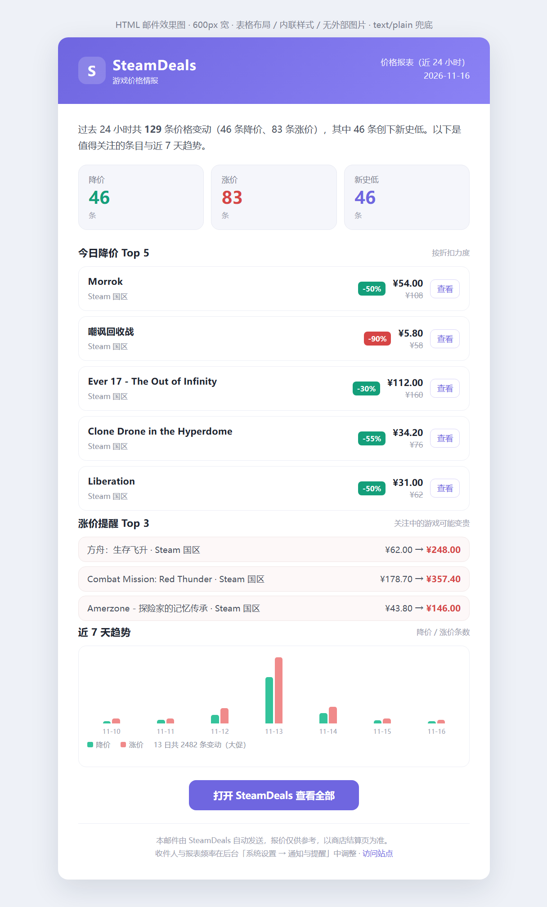

# 价格报表邮件 HTML 化 + 内容增强（待开发）

> 状态：**已实现待发版（2026-11-16，所有者派发开工；本地验证全绿，待质检）**。编号 **CB**。
> 关联：[MAIL-CONFIG-PAGE.md](MAIL-CONFIG-PAGE.md)（邮件服务配置）、`docs/USER-LIFECYCLE.md` §4.4（HTML 邮件先例）、
> [TODO.md](TODO.md) 的 CB 条目。

## 1. 现状（2026-11-16 核对）

| # | 事实 | 证据 |
|---|---|---|
| 1 | 价格报表由调度任务 `report` 每天执行：`report price --hours 24 --notify`（`REPORT_ENABLED`/`REPORT_INTERVAL_MIN`，默认 1440 分钟） | `src/scheduler.js:209-214` |
| 2 | 邮件正文是**纯文本**：`cmdReport` 拼 `text` 行（标题/统计/Top 5 降价/Top 3 涨价/近 7 天），再 `deliver()` | `src/cli.js:2354-2370` |
| 3 | 邮件层**已支持 HTML**：`buildMessage({html})` 输出 `multipart/alternative`（text/plain + text/html 双段 base64），有测试 | `src/notify.js:92-126`、`test/notify-html.test.js` |
| 4 | 但 `deliver()` 只把 `text` 传给邮件通道，**`html` 参数没有透传** | `src/notify.js:324-330` |
| 5 | 站点已有 HTML 转义/金额/图表工具可复用（`esc`、`fmtYuan` 等） | `src/report.js` |
| 6 | 没有"站点公开 URL"设置；CLI 场景拿不到 `req`，邮件里的站内链接需要配置项 | `src/settings.js`（无 `site.publicUrl`） |

## 2. 需求（2026-11-16 所有者）

邮件内容太枯燥，**做成 HTML** 并**丰富内容**：保留数据准确性，增加品牌头、统计卡、可点击链接、近 7 天趋势可视化，手机上也好看。

## 3. 设计

### 3.1 渲染模块（CB-1）

新增 `src/price-report-html.js`（纯函数、零依赖、可单测）：

```js
renderPriceReport({ report, daily, siteUrl, siteName, now = new Date() })
  → { subject, html, text }
```

- `report` 来自 `db.priceChanges()`（含 `drops/rises/newLows/changed/topDrops/topRises`）；
- `daily` 来自 `db.priceChangesByDay()`（`{day, drops, rises, changed}`）；
- `text` 保留现有纯文本口径（作为 `multipart/alternative` 的 fallback，也供 webhook/企微使用）；
- **HTML 只用内联 CSS + table 布局**：600px 居中、无外部图片/字体/CSS、无 flex/grid；
  兼容 QQ/163/企业微信邮箱、手机邮箱；`@media (max-width:480px)` 做单列适配；
- 所有动态字段（游戏名/平台名/日期）必须 **HTML 转义**；金额整数分 → `¥x.xx`；折扣取整；
- 链接：
  - 站内：`${siteUrl}/`（首页）、`${siteUrl}/?q=${encodeURIComponent(name)}`（站内搜索）；
  - Steam：`https://store.steampowered.com/app/<appid>/`（有 `steam_appid` 才出）；
  - 所有 URL 只接受 `http(s)`，由代码构造，不从数据里取 URL。

### 3.2 邮件内容结构



1. **品牌头**：SteamDeals 标识 + 「价格报表」+ 日期（如 `2026-11-16 · 近 24 小时`）；
2. **KPI 三卡**：降价 `46` / 涨价 `83` / 新史低 `46`（大数字 + 说明）；
3. **今日降价 Top 5**：名称（链接站内搜索）、平台、`¥原价 → ¥现价`、`-50%` 折扣徽标、`Steam ↗`；
4. **涨价提醒 Top 3**：紧凑行（名称、`¥旧 → ¥新`），提示"关注中的游戏可能变贵"；
5. **近 7 天趋势**：用 table 画迷你柱状条（降/涨两色）+ 每日数值，不依赖图片；
6. **CTA**：按钮「打开 SteamDeals」→ `${siteUrl}/`；
7. **页脚**：`本邮件由 SteamDeals 自动发送` + 站点链接 + 报表频率说明（不提供一键退订：收件人由后台配置，见设置页说明）。

### 3.3 投递链路（CB-2）

- `deliver(channels, { text, html = null, payload, subject, logger })`：email 通道传 `html`，webhook/wecom 仍只发 `text`；
- `cmdReport --notify`：调用 `renderPriceReport()` 生成 `{subject, html, text}`（无论是否有 email 通道都生成，成本可忽略）；
- subject 建议：`SteamDeals 价格报表 · 11-16 | 降价 46 / 新史低 46`（去 CR/LF 由 `encodeSubject` 兜底）；
- 邮件通道发送失败保持现有语义（结果里 `ok:false`、日志 `notify.*`、CLI 退出码 1）。

### 3.4 设置项（CB-3）

- 新增设置：`site.publicUrl`（env `SITE_PUBLIC_URL`，默认 `https://sd.yyliucha.cn`），供邮件/后台生成的站内链接使用；
- 不新增"HTML 开关"：邮件统一 HTML + 文本兜底；企业微信/webhook 保持纯文本。

## 4. 验收

1. `renderPriceReport()` 单测：包含 KPI 数字、Top 5/3 条数、金额与折扣、7 天数值、站内与 Steam 链接；
   游戏名含 `<script>`/引号时被转义；无外部图片/CSS URL；HTML 里无 `flex`/`grid`。
2. `deliver()` 单测：email 通道收到 `html` → `buildMessage` 输出 `multipart/alternative` 两段；webhook/wecom 只发 text。
3. CLI 单测/本地假 SMTP：`report price --notify` 发出的邮件含 `multipart/alternative`，HTML 段可解码且含 KPI；
   纯文本段仍是原口径（fallback）。
4. 真机/客户端：QQ 邮箱、163、企业微信邮箱、手机邮件客户端打开显示正常（600px 内、无横向滚动、按钮可点）。
5. `npm test` 全绿；`npm run scan` 通过（新增模块无敏感信息）。
6. 部署侧：后台邮件配置好后，手动执行一次 `node src/cli.js report price --notify`（部署验证步骤），确认收到的邮件为 HTML。

## 5. 本批不做

1. 做可视化模板编辑器（报表 HTML 固定，账号邮件模板仍走现有模板变量）；
2. 图表转图片/外部托管（全部 table/inline CSS）；
3. 改变推送频率、收件人配置方式（仍走设置页/环境变量）；
4. 企业微信/webhook 富文本（它们的 text 口径不变）；
5. 附件（CSV 仍用 CLI `--csv` 重定向）。

## 6. 实施顺序

| 子项 | 内容 | 依赖 |
|---|---|---|
| **CB-1** | `src/price-report-html.js` + 单测（渲染/转义/链接/7 天条） | 无 |
| **CB-2** | `deliver()` 透传 html + `cmdReport` 接入 + 邮件/CLI 测试 | CB-1 |
| **CB-3** | `site.publicUrl` 设置项 + 文档（MAIL-CONFIG-PAGE 补一节） | CB-1 |

## 7. 待确认（有默认值，不阻塞）

1. subject 格式（默认含日期 + 降价/新史低数字）；
2. `site.publicUrl` 默认值（默认 `https://sd.yyliucha.cn`）；
3. 页脚是否要放"在后台关闭报表"的说明（默认放一句频率说明，不放退订链接）。
